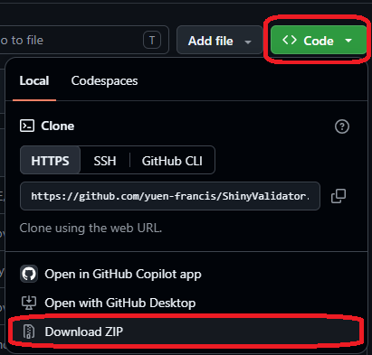
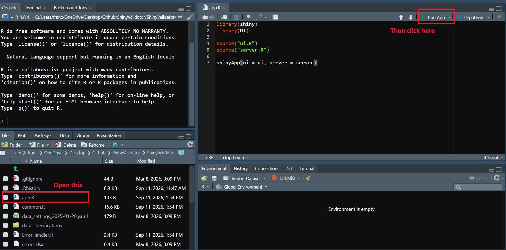

# ShinyValidator

Current version: 2.1.1 (Oct 13, 2026)

See the [Changelog](changelog.md) for a history of updates.

ShinyValidator is a customizable tool for checking research datasets against predefined data specifications. Upload a CSV to identify common data-entry errors, such as missing columns, invalid values, and formatting issues, and download a highlighted Excel file to help locate and correct them. For common, unambiguous mistakes (such as capitalization), the validator can also suggest fixes, which are only applied after you approve them.

ShinyValidator is designed as a template that can be adapted to the requirements of your own project. Importantly, the tool was designed to *minimize the need to interface with R*, such that users with minimal R knowledge can nonetheless adapt the validator with ease.

Fork or download this repository to customize it for your project, and use it as an app locally or deploy it using the `rsconnect` package.

You can find a live version of this template [here](https://manybabies.shinyapps.io/shinyvalidator/).

## Components of this repository

This documentation is divided into seven sections:

1. [Primary Functions](#1-primary-functions) — how to use the validator and create specifications/configurations.
2. [Adapting the Validator](#2-adapting-the-validator) — how to customize the validator for your own project.
3. [Back-end Developer Documentation](#3-back-end-developer-documentation) — how the validator works and how to modify its code.
4. [File and Folder Structure](#4-file-and-folder-structure)
5. [Summary of the Recommended Workflow](#5-summary-of-the-recommended-workflow)
6. [Package and Version Control](#6-package-and-version-control)
7. [Testing](#7-testing) — how to run the automated tests and what they cover.

If you are simply creating a validator for your own project, you only need **Sections 1 and 2**.

---

# 1. Primary Functions

The validator contains five main functions, divided into two categories:

### Validator Functions

* **Validation Results** — validate a dataset and identify errors.
* **Specification Details** — view the requirements of the selected data specification.
* **Verify Certified File** — check that a certified CSV is exactly the file that passed validation.

### Creation Functions

* **Specification Creation** — create a data specification without manually writing YAML.
* **Configuration Creation** — customize the validator's user-facing content and settings without manually editing configuration YAML.

---

<details>
<summary><strong>Requirements</strong></summary>

To run the validator locally, you will need:

* **R** (version 4.6.1)
* **RStudio**

The following R packages are required:

* `tidyverse` (version 2.0.0)
* `shiny` (version 1.14.0)
* `DT` (version 0.34.0)
* `openxlsx` (version 4.2.9)
* `yaml` (version 2.3.12)
* `digest`

If you plan to deploy the validator to shinyapps.io, you will also need:

* `rsconnect` (version 1.11.0)

To run the automated tests (developers only; see [Section 7](#7-testing)), you will also need:

* `testthat`
* `shinytest2` (also requires Google Chrome or Chromium)
* `withr`

The exact package environment used by the validator is recorded in `renv.lock`. Running `renv::restore()` will install the versions specified in the lockfile.


</details>

<details>
<summary><strong>Using the Validation Results function</strong></summary>

The **Validation Results** function is the primary way to validate a dataset.

1. **Select a configuration** from the *Configuration* drop-down menu.

- Alternatively, use the "Local YAML Configuration" function to select a local configuration

2. **Select a study** from the *Study* drop-down menu.

- Alternatively, use the "Local YAML Specification" function to select a local specification.

3. **Select a format** from the *Study Format* drop-down menu.

4. **Upload your dataset** by clicking *Browse* and selecting the `.csv` file you want to validate.

5. **Review the validation results.** The validator will indicate whether your dataset is valid.

6. If errors are found, use the **View errors by** options to display errors by:

   * column; or
   * row.

7. **Review any suggested fixes.** If some of the errors are common mistakes that can be corrected with confidence, a **Suggested fixes** panel appears above the data table. Nothing is changed until you approve it. See *Using Suggested fixes* below.

8. You can **directly edit your dataset** using the preview table displayed in the app. The validator will check your edits in real-time and remove highlight if errors no longer persist.
   
9. **Download an edited and highlighted file** by clicking *Download Edited & Highlighted Excel File*. This produces an Excel file containing the original dataset with invalid cells highlighted, along with an **Error Log** describing the detected errors. If you applied suggested fixes, the file also contains a **Change Log** sheet listing every change. This downloaded copy will also preserve any edits made in the data table display.

10. Once your data passes validation, the **Download Validated CSV File** button will appear for you to enter your labid download a standardized .csv for submission. The Lab ID may contain only letters, numbers, and hyphens. The generated file name will have the following naming scheme: "labID_Study_Format_CODE".

> **WARNING:** Do not alter the auto-generated file name or change any of the file contents after saving! Opening and re-saving the file in a spreadsheet program such as Excel can also change it. The autogenerated code is an authenticator to show that this is a version-locked dataset that has passed validation.

The available studies and formats depend on the specifications associated with the selected configuration.

</details>

<details>
<summary><strong>Using Suggested fixes</strong></summary>

The **Suggested fixes** panel proposes corrections for cells that currently fail validation when the correct value can be worked out reliably, for example a value typed in the wrong case.

**Nothing is changed automatically.** Each suggestion shows the row, the column, the current value, the proposed value and the reason, and you decide what to apply.

1. Open the **Suggested fixes** panel above the data table.

2. Each suggestion is marked either:

   * **Safe** — only one reasonable correction exists; or
   * **Check this one** — a likely correction, but one you should look at before accepting.

3. Select the rows you want to apply. **Select all safe fixes** selects every Safe suggestion at once.

4. Click **Apply selected fixes.** The edits are made in the data table, and the dataset is re-validated straight away.

5. Click **Undo last applied fixes** if you change your mind.

6. Open the **Change log** to see every change made in this session. If you download the Excel file, the same list is included as a **Change Log** sheet.

Things to know:

* Only cells that currently fail validation are ever offered a fix.
* A proposed value is only offered if it passes the field's own rules in the specification. The validator never suggests a value it would then reject.
* Typical fixes include capitalization, extra leading, trailing or repeated spaces, accented characters, and look-alike punctuation or decimal marks, depending on the field's rules.
* If more than one correction would be valid and the validator cannot tell which is meant, it makes no suggestion.
* Missing columns, unexpected columns and values with no valid correction are never fixed. You need to correct these yourself.
* Suggested fixes can be switched off for a whole project (`allow_suggested_fixes` in the configuration) or for a single variable (`auto_fix: no` in the specification). See Sections 2.3 and 2.5.
* Fixes are applied to the copy of the data in the app. Your original file is not modified.

</details>

<details>
<summary><strong>Using the Specification Details function</strong></summary>

The **Specification Details** function displays a human-readable description of the selected data specification.

This allows users to check the requirements being applied to their dataset without opening the underlying YAML file.

The specification includes information such as:

* required variables;
* variable descriptions;
* field types;
* allowed values;
* numeric restrictions;
* string restrictions; and
* other validation requirements.

The explanatory text displayed in this section can be customized through the selected configuration.

</details>

<details>
<summary><strong>Using the Verify Certified File function</strong></summary>

The **Verify Certified File** function lets an admin or data processor check whether a CSV downloaded with *Download Validated CSV File* is exactly the file that passed validation.

1. Select **Verify Certified File** in the navigation menu.

2. **Upload the certified CSV.** Keep the auto-generated file name (`labID_Study_Format_CODE.csv`) unchanged.

3. **Check the Lab ID, Study and Format boxes.** They are filled in automatically from the file name. If the study name contains an underscore, the study and format cannot be separated automatically, so enter them exactly as they were when the file was certified.

4. Click **Verify file.**

The result is either:

* **✓ Verified** — the file is exactly the one that was certified by this validator; or
* **✖ Not verified** — with a short reason, for example that the file was changed after it was certified or that the Lab ID, study or format does not match.

Things to know:

* Verification uses the same secret key as the downloads. The page only reports pass or fail and never shows the key.
* Any change to the file causes it to fail, including a single edited cell or re-saving in Excel.
* Files certified with a different secret key will not verify.
* Anyone who can open the app can use this page.

</details>

<details>
<summary><strong>Data types that the validator can check</strong></summary>

The validator can check:

* **Required columns** — whether all required variables are present.
* **Options** — whether values match a predefined list of allowed values.
* **Numeric values** — whether values are numeric and meet specified range and decimal requirements.
* **Strings** — whether text meets specified capitalization and character-length requirements.
* **Regular expressions** — whether values follow a specified pattern.

The specific checks performed depend on the data specification.

</details>

<details>
<summary><strong>Using Specification Creation</strong></summary>

The **Specification Creation** function allows users to create a YAML data specification without manually writing YAML code.

You have two options for initiating the specification creation:

1. Entering the number of variables required in the specification. The validator will then generate an interface for defining each variable.

2. Upload a sample/template dataset. The validator will extract the column names, and generate an interface for you to provide further specification.

For each variable, you can specify:

* variable name;
* description;
* field type;
* whether the field is required;
* whether `NA` values are allowed;
* allowed options;
* numeric restrictions;
* string restrictions; and
* examples for generating regular-expression restrictions.

Once the specification is complete, click **Download Setup** to download the resulting YAML file.

> **Important:** You can change the number of variables at any time, but decreasing the number of variables will erase some of your progress. For example, reducing the number of variables from 10 to 9 will permanently remove the settings for variable 10.

See **Section 2.5: Creating your data specification** for more information about the available field types and specification workflow.

</details>

<details>
<summary><strong>Using Configuration Creation</strong></summary>

The **Configuration Creation** function allows you to customize the validator without manually editing the configuration YAML file.

Configuration Creation can be used to define:

* the application title;
* a custom logo;
* the colour theme (blue, purple or teal), with a live preview;
* whether suggested fixes are offered to users;
* the welcome message;
* a secondary message;
* the name and contents of **Instruction Set 1**;
* the name and contents of **Instruction Set 2**;
* links displayed in the validator; and
* the specification message.

The names of the instruction sets are customizable. For example, instead of calling the first section *Instruction Set 1*, a project could call it **Getting Started** or **Before You Begin**.

Similarly, the second section could be renamed to something such as **Upload Instructions** or **Data Submission Instructions**.

A custom logo can also be enabled and uploaded through **Configuration Creation**. The uploaded image is saved automatically to the `logos` folder using its original filename, and the filename is automatically recorded in the generated configuration.

Once the configuration is complete, click **Download Configuration** to download the YAML configuration file.

The downloaded configuration can then be placed in the `configuration` folder and selected from the application's **Configuration** drop-down menu.

This allows the same ShinyValidator codebase to support multiple projects or studies with different user-facing instructions and settings.

</details>

<details>
<summary><strong>Creating your own validator</strong></summary>

ShinyValidator is designed as a template. A typical workflow for creating a validator for your own project is:

1. Download or fork the repository.
2. Create or customize a configuration.
3. Create one or more data specifications.
4. Add your specifications to the `data_specifications` folder.
5. Test the validator using example datasets.
6. Customize the appearance or underlying code if needed.
7. Run the validator locally or deploy it online.

> **Try it out:** Launch the validator and try out the built-in Demo specification. The extracted R Project contains a `sample_datasets` folder with valid and invalid datasets. Run these through the validator to see what the output looks like before creating your own specifications.

See **Section 2: Adapting the Validator** for step-by-step instructions.

</details>

---

# 2. Adapting the Validator

This section provides a step-by-step guide for adapting the validator template for your own project.

Before proceeding, please make sure you have everything in the **Requirements** section above installed.

---

<details>
<summary><strong>2.1 Downloading the validator</strong></summary>

The first step is to download the validator from the repository.

Click **Code → Download ZIP** to download the repository as a `.zip` file, then extract it using any file compression program.



</details>

<details>
<summary><strong>2.2 Running the validator locally</strong></summary>

The quickest way to get your validator running is to run it locally.

Open the R Project file `ShinyValidator.Rproj`. Then open `app.R` and click **Run App**.



Note that the exact location of these buttons may differ depending on your RStudio setup. You may be prompted to install any required packages that are not already installed.

The template version of the validator should open in a new window.

You can use this version to create and test your customized configurations and data specifications.

### Important note for Admin

The Validator requires a secret key to generate authenticated downloads. The same key is used by the **Verify Certified File** page to check them.

When the Validator is run locally, no manual key setup is required. When it is run for the first time, it automatically:

1. Generates a secure secret key.
2. Saves the key locally in `.Renviron`.
3. Uses the key to authenticate downloads.

To start the Validator, open the project in RStudio and click **Run App**.

The `.Renviron` file is excluded from Git and should never be committed or shared.

When the Validator is deployed to a server, the key must be provided to the app as the `VALIDATOR_SECRET_KEY` environment variable, and it must be the **same every time the app starts**. If the key changes, files that were certified earlier will no longer verify.

</details>

<details>
<summary><strong>2.3 Understanding configurations</strong></summary>

ShinyValidator separates the **application configuration** from the **data specifications**.

Configurations are stored in the `configuration` folder as YAML files whose names begin with:

```text
config_
```

For example:

```text
config_ManyBabies.yaml
config_default.yaml
```

The configuration controls the user-facing content of the application, including:

* application title;
* colour theme;
* whether suggested fixes are offered;
* welcome message;
* secondary message;
* instruction set names;
* instruction set contents;
* links; and
* specification message.

This means that the same ShinyValidator code can be used with different configurations without modifying the underlying R code.

### Configuration structure

A configuration file follows this general structure:

```yaml
app_title: My Data Validator

theme: blue # blue, purple or teal

allow_suggested_fixes: yes # yes or no; set to no to hide the Suggested fixes panel

welcome_message: Welcome to the validator!

secondary_message:

instruction_set_1_name: Getting Started
instruction_set_1:
- Select a study
- Select a format
- Upload your dataset

links:
- text: Project Website
  url: https://example.com/

instruction_set_2_name: Upload Instructions
instruction_set_2:
- Upload your CSV file
- Check the validation results

specification_message: This is the specification used to validate your dataset.
```

The exact contents can be customized to suit your project. Links are only shown if they begin with `http://` or `https://`. If `allow_suggested_fixes` is left out, suggested fixes are offered.

For most users, the easiest way to create a configuration is to use **Configuration Creation** within the application rather than editing YAML manually.

</details>

<details>
<summary><strong>2.4 Customizing the GUI</strong></summary>

The validator contains several user-facing elements that can be customized for your project.

Most of the content can be changed through the **Configuration Creation** function rather than directly modifying `ui.R`.

The following table summarizes the main customization options:

| Interface element          | Recommended method     | What can be changed                                |
| -------------------------- | ---------------------- | -------------------------------------------------- |
| **Application title**      | Configuration Creation | Application name displayed at the top              |
| **Custom logo**            | Configuration Creation | Upload and display a project logo                  |
| **Colour theme**           | Configuration Creation | Blue, purple or teal accent colours                |
| **Suggested fixes**        | Configuration Creation | Turn the Suggested fixes panel on or off           |
| **Welcome message**        | Configuration Creation | Main introductory message                          |
| **Secondary message**      | Configuration Creation | Additional introductory text                       |
| **Instruction Set 1**      | Configuration Creation | Section name and instructions                      |
| **Instruction Set 2**      | Configuration Creation | Section name and instructions                      |
| **Links**                  | Configuration Creation | Link text and destination URLs                     |
| **Specification message**  | Configuration Creation | Description shown above specification details      |
| **Study selection**        | `ui.R` / `app_server.R`    | Labels and interface behavior                      |
| **Study format selection** | `ui.R` / `app_server.R`    | Labels and interface behavior                      |
| **CSV upload**             | `ui.R`                 | Upload label and accepted file types               |
| **Error display**          | `ui.R`                 | Labels and display options                         |
| **Validation preview**     | `ui.R` / `app_server.R`    | Layout and behavior                                |
| **Overall appearance**     | `ui.R`                 | Colors, spacing, fonts, cards, buttons, and layout |

The exact line numbers may change as you customize the application, so it is better to search for the relevant element or input ID rather than relying on line numbers.

> **Tip:** For most projects, you should not need to modify `ui.R` or `app_server.R`. Use **Configuration Creation** whenever possible.

</details>

<details>
<summary><strong>2.5 Creating your data specification</strong></summary>

The next step is to specify what columns your dataset must contain and what values are allowed for each column.

Data specifications are stored as `.yaml` files in the `data_specifications` folder.

However, **you do not need to write the YAML code yourself**.

Instead, open the validator and navigate to the **Specification Creation** function.

Enter the number of variables you want to include in your specification. The validator will then generate fields for you to define each variable.

There are three main variable types:

* **Options** — values must match one of a predefined set of options.
* **Numeric** — values must be numeric and can optionally be restricted by range and decimal requirements.
* **String** — values can be open-ended but can be restricted by capitalization, character length, or a regular expression.

### Options

Use **Options** when you want to specify exactly which values are allowed.

For example, a `color` variable could allow only:

* `red`
* `yellow`
* `blue`

### Numeric

Use **Numeric** when a variable should contain numbers.

You can optionally specify:

* a minimum value;
* a maximum value;
* whether decimal values are allowed; and
* the minimum and maximum number of decimal places.

For example, a `reaction_time_ms` variable could be restricted to values between `300` and `10000`.

### String

Use **String** when a variable contains open-ended text.

You can optionally restrict:

* capitalization;
* minimum character length; and
* maximum character length.

You can also provide examples to generate a regular-expression-based restriction for variables that follow a consistent pattern.

### Turning off suggested fixes for one variable

If a variable should never be corrected by the validator, even when the correction looks obvious, add `auto_fix: no` to that variable when editing the specification YAML by hand:

```yaml
- name: participant_id
  type: string
  auto_fix: no
```

Errors in that variable are still reported as normal. They are just never offered a suggested fix.

</details>

<details>
<summary><strong>2.6 Adding your data specification</strong></summary>

Once you have finished defining your variables, click **Download Setup** to download your `.yaml` specification.

Data specifications must be named according to the configuration, study, and format they belong to.

The general naming structure is:

```text
configuration_study_format.yaml
```

For example:

```text
ManyBabies_FishSpeed_RawData.yaml
```

This identifies:

| Component     | Value        |
| ------------- | ------------ |
| Configuration | `ManyBabies` |
| Study         | `FishSpeed`  |
| Format        | `RawData`    |

The configuration name corresponds to the configuration file:

```text
config_ManyBabies.yaml
```

The specification should then be placed in:

```text
data_specifications/
```

For example:

```text
data_specifications/
└── ManyBabies_FishSpeed_RawData.yaml
```

> **Important:** The configuration, study, and format names must match the names used by the application. Avoid spaces and special characters in filenames.

After adding the file, relaunch the application. The appropriate study and format should now appear when the corresponding configuration is selected.

</details>

<details>
<summary><strong>2.7 Testing your specification</strong></summary>

Before using your validator with real datasets, test your new specification with a small sample dataset.

Ideally, create a `.csv` file containing:

* at least one row with completely valid data; and
* several rows containing errors that you expect the validator to detect.

Upload this dataset to the validator and check that the expected errors are identified.

Test several types of errors, including:

* missing required columns;
* invalid option values;
* invalid numeric values;
* values outside permitted ranges;
* incorrect decimal places;
* incorrect capitalization;
* strings that are too short or too long; and
* values that do not match regular-expression requirements.

If you have not turned suggested fixes off, check the **Suggested fixes** panel too. For example, an option value typed in the wrong case should be offered a fix, and applying it should clear the error.

You can also click **Download Highlighted File** to create an Excel version of the dataset with invalid cells highlighted.

To get a starting dataset, click **Generate Sample Dataset**. It downloads a CSV of example values that satisfy the selected specification, which you can then edit to introduce errors on purpose.

</details>

<details>
<summary><strong>2.8 Creating a configuration</strong></summary>

If your project requires customized instructions or multiple configurations, use the **Configuration Creation** function.

The configuration creator allows you to specify:

### Application information

* Application title
* Custom logo
* Colour theme
* Suggested fixes on or off
* Welcome message
* Secondary message

### Instructions

* Instruction Set 1 name
* Instruction Set 1 content
* Instruction Set 2 name
* Instruction Set 2 content

The instruction set names are fully customizable. This allows the same underlying application to use terminology appropriate to different projects.

### Links

You can add links to relevant project websites, documentation, registration pages, or other resources.

### Specification information

You can define the message displayed above the human-readable specification.

Once complete, click **Download Configuration**.

Place the resulting file in:

```text
configuration/
```

Configuration files should follow the naming convention:

```text
config_ProjectName.yaml
```

For example:

```text
config_ManyBabies.yaml
```

The project name is then used to associate the configuration with its corresponding data specifications.

If a custom logo is enabled, the uploaded image is saved in the project's `logos/` folder. The configuration YAML records the logo filename so that the image can be displayed when that configuration is selected.

</details>

<details>
<summary><strong>2.9 Making manual adjustments</strong></summary>

If you discover that your configuration or specification needs to be changed after testing, you can either recreate it using the appropriate creation function or edit the `.yaml` file directly.

The YAML files contain the same information represented by the creation interfaces, but in a format that can be edited manually.

For most users, the **Specification Creation** and **Configuration Creation** functions are the easiest way to make changes.

Manual editing can be useful when making small changes to an existing configuration or specification.

> **Note:** In YAML, an unquoted `yes` or `no` is read as true or false, not as text. If a variable's options are the words yes and no, write them in quotes: `options: ['yes', 'no']`. Specifications made with **Specification Creation** already do this.

Once your validator is working as expected, you can use it locally or deploy it online using `shinyapps.io`.

</details>

<details>
<summary><strong>2.10 Deploying the validator</strong></summary>

Once your validator has been tested locally, it can be deployed to `shinyapps.io` using the `rsconnect` package.

A typical deployment workflow is:

1. Install `rsconnect`.
2. Connect RStudio to your `shinyapps.io` account.
3. Open the ShinyValidator project.
4. Run the application locally and confirm that it works.
5. Deploy the application using the RStudio publishing tools or `rsconnect`.

The configuration files and data specifications contained in the project should be included in the deployed application. The `tests/` folder is not needed by the deployed application and can be left out.

Make sure the `VALIDATOR_SECRET_KEY` environment variable is available to the deployed app and stays the same between restarts (see **Section 2.2**). After deploying, test the **Download Validated CSV File** and **Verify Certified File** functions on the deployed copy.

</details>

---

# 3. Back-end Developer Documentation

The **Back-end Developer Documentation** provides detailed information about the underlying code of the validator.

This section is intended for researchers and developers who wish to add new functions, modify existing functionality, or otherwise customize the validator beyond the options described in Section 2.

If you only want to create a validator for your own project, you generally do not need to modify the code described in this section.

---

<details>
<summary><strong>3.1 Application architecture</strong></summary>

The validator is organized across five primary R files:

| File             | Purpose                                            |
| ---------------- | -------------------------------------------------- |
| `app.R`          | Application initialization and launch              |
| `ui.R`           | User interface, layout, and styling                |
| `app_server.R`   | Server-side application logic and reactive outputs |
| `common.R`       | Shared functions, dataset validation, suggested fixes, and certified-file signing and verification |
| `ErrorHandler.R` | Error handling and downloadable validation reports |

> **Note:** The server file is named `app_server.R` rather than `server.R` so that the project folder is not ambiguous. A folder containing both `app.R` and `server.R` can be launched in two different ways, and tools such as `shinytest2` refuse to start it.

The validator also relies on two important collections of YAML files:

| Folder                 | Purpose                                                    |
| ---------------------- | ---------------------------------------------------------- |
| `configuration/`       | Defines application-level settings and user-facing content |
| `data_specifications/` | Defines study- and format-specific dataset requirements    |

The general relationship between these components is:

```text
Configuration
     │
     ├── Application title
     ├── Theme
     ├── Suggested fixes on/off
     ├── Instructions
     ├── Links
     └── Specification message
     │
     ▼
Selected configuration
     │
     ▼
Study + Format
     │
     ▼
Data specification
     │
     ▼
Uploaded CSV
     │
     ▼
validate_dataset()
     │
     ├── Validation Results
     ├── Validation Preview
     ├── Error Display
     ├── Suggested Fixes (suggest_fixes → approval → apply_fixes → re-validate)
     ├── Highlighted Excel Download (with Change Log sheet)
     └── Certified CSV Download ──► Verify Certified File
```

</details>

<details>
<summary><strong>3.2 Configuration system</strong></summary>

The configuration system allows the same Shiny application code to support multiple projects or study collections.

Configuration files are stored in:

```text
configuration/
```

and must begin with:

```text
config_
```

For example:

```text
config_default.yaml
config_ManyBabies.yaml
```

`ui.R` identifies available configuration files automatically using the filename pattern:

```r
^config_.+\.(yaml|yml)$
```

The selected configuration is loaded reactively in `app_server.R`.

The configuration determines application-level content such as:

```yaml
app_title:
theme:
allow_suggested_fixes:
welcome_message:
secondary_message:
instruction_set_1_name:
instruction_set_1:
links:
instruction_set_2_name:
instruction_set_2:
specification_message:
```

This approach means that user-facing content can be changed without modifying the application logic.

`allow_suggested_fixes` is read with `!isFALSE(...)`, so the Suggested fixes panel is shown unless the setting is explicitly `no` / `false`.

### Configuration-specific specifications

Specifications are associated with configurations through their filenames.

For a configuration:

```text
config_ManyBabies.yaml
```

a corresponding specification might be:

```text
ManyBabies_MB1_subjects.yaml
```

The configuration name is extracted from the configuration filename and used by `app_server.R` to identify the appropriate specifications.

This prevents specifications belonging to different projects from being mixed together.

</details>

<details>
<summary><strong>3.3 app.R</strong></summary>

`app.R` is the entry point for the Shiny application. It:

1. Loads the core application components.
2. Sets the maximum upload size (50 MB).
3. Sources `ui.R` and `app_server.R`.
4. Launches the application with `shinyApp()`.

The file generally does not need to be modified when adapting the validator.

If additional R files are added, they should generally be sourced from the appropriate component file rather than directly from `app.R`.

</details>

<details>
<summary><strong>3.4 ui.R</strong></summary>

`ui.R` defines the application's user interface, layout, and visual styling.

The sidebar provides:

* configuration selection;
* study selection;
* format selection;
* CSV upload; and
* navigation between the validator functions.

The main panel contains five functions:

* **Validation Results**
* **Specification Details**
* **Specification Creation**
* **Configuration Creation**
* **Verify Certified File**

### Dynamic UI

Several parts of the interface are generated dynamically using `uiOutput()` and server-side `renderUI()` calls.

Examples include:

* study selection;
* study format selection;
* configuration creation fields;
* specification creation variable tabs;
* validation errors;
* the Suggested fixes panel (`suggested_fixes_panel`, placed above the validation preview);
* specification details;
* the Lab ID, study and format fields on the Verify Certified File page.

### JavaScript components

A small JavaScript component in `ui.R` updates dynamically generated labels in the specification and configuration creation interfaces.

For example, variable tabs are automatically renamed as users enter variable names.

The configuration creation interface also updates the displayed instruction-set headings when users change the names of Instruction Set 1 or Instruction Set 2.

A second component handles the text-size buttons and remembers the chosen size in the user's browser.

These JavaScript components should generally be left unchanged unless the corresponding UI elements are modified.

### Styling

The application uses custom CSS in `ui.R` to provide:

* application header styling;
* content cards;
* theme accent colors (blue, purple or teal, selected by the configuration's `theme`);
* styled navigation;
* form controls;
* buttons;
* validation tables; and
* other visual elements.

The colours are defined as CSS variables, one set per theme, so a new theme can be added by defining another set of variables.

The application uses `DT` for interactive validation tables.

</details>

<details>
<summary><strong>3.5 app_server.R</strong></summary>

`app_server.R` contains the server-side logic for the application (it defines the `server` function used by `app.R`). It connects UI inputs to the validation functions in `common.R` and generates the application's outputs.

### Configuration loading

The selected configuration is loaded using a reactive expression:

```r
selected_config <- reactive({
  req(input$configuration)
  req(
    input$configuration %in%
      list.files("configuration", pattern = "^config_.+\\.yaml$")
  )
  read_yaml_safe(file.path("configuration", input$configuration))
})
```

A configuration uploaded through the "Local YAML Configuration" function is read in the same way.

The configuration name is also extracted from the selected filename so that the appropriate data specifications can be identified.

### Study and format selection

Available specifications are determined from the selected configuration.

For example, if the selected configuration is:

```text
ManyBabies
```

the application searches for specifications beginning with:

```text
ManyBabies_
```

This allows different configurations to have different collections of studies and formats.

### Main server components

`app_server.R` contains logic for:

* loading the selected configuration;
* identifying available specifications;
* generating study and format selectors;
* displaying configuration-specific instructions;
* displaying specification details;
* validating uploaded datasets;
* displaying errors by column or row;
* generating the validation preview;
* proposing, applying and undoing suggested fixes, and keeping the change log;
* generating highlighted Excel downloads;
* creating specification fields dynamically;
* creating configuration fields dynamically;
* generating downloadable YAML specifications;
* generating downloadable YAML configurations; and
* verifying certified CSV files.

### Validation workflow

The main validation outputs follow this general workflow:

1. Identify the selected configuration.
2. Identify the selected study and format.
3. Construct the corresponding specification filename.
4. Load the YAML specification.
5. Read the uploaded CSV dataset.
6. Pass the specification and dataset to `validate_dataset()` in `common.R`.
7. Process the returned issues.
8. Display the results or generate the highlighted Excel file.

### Suggested fixes

The suggested-fixes logic sits between steps 7 and 8 above:

1. If the configuration does not set `allow_suggested_fixes` to `no`, the server calls `suggest_fixes()` with the specification and the current dataset.
2. The result is shown in the Suggested fixes panel as a `DT` table. Cell values are shown as plain text (HTML escaping is left on), so a value from a dataset cannot inject markup into the page.
3. Nothing changes until the user selects rows and clicks **Apply selected fixes**. The server then calls `apply_fixes()`, stores the previous values so they can be restored by **Undo last applied fixes**, and appends the changes to the change log.
4. The edited dataset is validated again, so highlighting, error counts and the certified CSV button all update from the corrected data.
5. When the Excel file is downloaded and the change log is not empty, a **Change Log** sheet is added to the workbook.

### Input safety

Because every value that reaches the server comes from the browser, the server does not trust it:

* YAML files are read with `read_yaml_safe()` in `common.R`, which does not evaluate R code inside YAML and rejects files larger than 1 MB.
* The selected configuration, study and format are checked against the files that actually exist before any file is opened, so a tampered request cannot be used to read other files.
* Links from a configuration are only shown if they use `http://` or `https://` (`safe_link_url()`), and they open with `rel="noopener noreferrer"`.
* Uploads are limited to 50 MB.
* A file that cannot be read (for example an empty file, a file that is not a CSV, or a broken YAML file) produces a message in the app rather than ending the session.
* Dataset values are never printed to the server log.

### Authenticated validated downloads

Validated CSV downloads are authenticated using an HMAC-SHA256 code.

When a user requests a validated download, the application:

1. collects and validates the user's Lab ID (letters, numbers, and hyphens only);
2. confirms again, on the server, that the dataset currently passes validation (the hidden button is not relied on);
3. generates the exact CSV contents that will be downloaded;
4. combines the Lab ID, study name, study format, and CSV contents;
5. generates an HMAC-SHA256 authentication code using the application's secret key;
6. truncates the resulting code to 16 hexadecimal characters for use in the filename; and
7. downloads the CSV using the Lab ID, study, format, and authentication code in the filename.

The secret key is stored outside the repository as the `VALIDATOR_SECRET_KEY` environment variable and should never be committed to version control.

The authentication code therefore provides a way to verify that a downloaded file was generated by the Validator and that its contents have not been modified. Verification requires access to the same secret key used by the Validator.

The authentication mechanism does **not** verify the identity or authorization of the person who entered the Lab ID. It establishes a cryptographic association between the supplied Lab ID and the exact file generated by the Validator.

### Verifying certified files

The **Verify Certified File** page uses the same code in reverse. It:

1. reads the Lab ID and the code from the uploaded file's name (`parse_certified_filename()`);
2. pre-fills the study and format when they can be recovered from the name, and otherwise asks the user to enter them;
3. recomputes the code from the Lab ID, study, format and the exact bytes of the uploaded file (`verify_download_code()`); and
4. reports **Verified** only if the recomputed code equals the code in the file name.

Lab IDs cannot contain underscores, which is what allows the Lab ID to be read from the file name. The study and format cannot always be recovered, because characters that are unsafe in file names are replaced with `_` when the file is named.

The signing function (`generate_download_code()`) lives in `common.R` and is shared by the download and the verification, so the two cannot drift apart. Its formula must not be changed without a plan for files that were certified earlier, because they would stop verifying.

### Specification paths

Configuration-specific specification paths generally follow:

```r
yaml_file_path <- paste0(
  "data_specifications/",
  selected_configuration_name(),
  "_",
  input$study,
  "_",
  input$format,
  ".yaml"
)
```

It is important that all validation-related outputs use this same configuration-aware naming structure.

</details>

<details>
<summary><strong>3.6 common.R</strong></summary>

`common.R` contains the core data-validation functions used by the application.

### Study and format discovery

Available specifications are identified from the YAML files stored in `data_specifications`.

The configuration name is used to distinguish specifications belonging to different configurations.

For example:

```text
ManyBabies_MB1_subjects.yaml
```

can be interpreted as:

| Component     | Value        |
| ------------- | ------------ |
| Configuration | `ManyBabies` |
| Study         | `MB1`  |
| Format        | `subjects`    |

Adding a correctly named specification automatically makes it available to the corresponding configuration.

### Dataset validation

`validate_dataset()` is the main validation function. It:

1. Checks that all required columns are present.
2. Passes each existing field to `validate_dataset_field()`.
3. Collects validation issues.
4. Returns whether the dataset is valid and, if not, a list of issues.

`validate_dataset_field()` determines which validation function should be used based on the field specification.

| Field type | Validation function                     |
| ---------- | --------------------------------------- |
| `options`  | `ValidateOption()`                      |
| `numeric`  | `ValidateNumeric()`                     |
| `string`   | `ValidateString()` or `ValidateRegex()` |

### Validation functions

The individual validation functions perform the following checks:

* **`ValidateOption()`** — checks whether values match one of the allowed options.
* **`ValidateNumeric()`** — checks numeric values, ranges, decimal restrictions, and decimal places.
* **`ValidateString()`** — checks capitalization and character-length restrictions.
* **`ValidateRegex()`** — checks values against a specified regular expression.
* **`GenerateRegex()`** — generates a regular expression from compatible example values.

All validation functions return the same basic structure:

```r
list(TRUE, NULL)
```

when the field is valid, or:

```r
list(FALSE, issue)
```

when an error is detected.

Issues contain information such as the error type, column, invalid value, and row number. This standardized structure allows the server and error-handling components to process validation errors consistently.

### Validation behaviour notes

* A field with no `required` setting is treated as required. A missing `NA_allowed` or `empty_allowed` setting means that `NA` values or empty cells are not allowed.
* Numeric values must be plain numbers. Values with spaces, hexadecimal notation, or `Inf` are invalid. Ranges include their limits.
* When a field requires at least one decimal place, a value written without a decimal point is invalid.
* A regular-expression field with a missing or invalid pattern produces an error rather than silently accepting every value.

### Suggested fixes

Two functions in `common.R` support the Suggested fixes panel.

* **`suggest_fixes(fields, dataset)`** — returns a data frame with one row per proposed fix and the columns `row`, `column`, `current`, `proposed`, `reason` and `confidence`. It returns no rows when there is nothing to suggest.
* **`apply_fixes(dataset, fixes)`** — writes the approved `proposed` values into the dataset. A fix is skipped if the cell no longer holds the `current` value it was proposed for, so a stale suggestion can never overwrite a newer edit.

The rules `suggest_fixes()` follows:

1. Only cells that currently fail validation are considered.
2. For each such cell, a list of candidate values is built from the current value (for example a different capitalization, trimmed spaces, accents removed, or a replaced character).
3. **Every candidate is re-validated against the field's own rules**, using the same validation code as `validate_dataset()`. A candidate that does not pass is dropped. A suggested fix can therefore never be rejected by the validator afterwards.
4. One candidate is then chosen, depending on the field:
   * `"ordered"` — the first candidate that passes is used; and
   * `"unique"` — a fix is only suggested if exactly one distinct candidate passes. If several would pass and it is unclear which is meant, nothing is suggested.
5. The fix is labelled `"safe"` or `"check"`. Use `"check"` for any fix that changes the meaning of a value more than formatting would.
6. Fields with `auto_fix: no` in the specification are skipped.

Fixes are never applied by these functions on their own. The decision to apply always rests with the user, in `app_server.R`.

Helper functions used here are `fix_strip_accents()`, `fix_key()`, `fix_replace_chars()` and `fix_candidates()`. To add a new kind of correction, add it to `fix_candidates()` and add a test in `tests/testthat/test-fixes.R`. Because candidates are re-validated, a new correction is safe to add as long as it is given the right confidence label.

### Error explanations

`explain_error()` converts validation issues into user-facing explanations.

It uses the field specification to describe the relevant requirement while allowing individual fields to provide a custom `error_message`.

### Other shared helpers

`common.R` also contains:

* **`read_yaml_safe()`** — reads a YAML file without evaluating code and with a size limit.
* **`safe_link_url()`** — returns a link only if it is a plain `http(s)` address.
* **`generate_download_code()`**, **`parse_certified_filename()`** and **`verify_download_code()`** — create and check the authentication code of certified CSV files.

### Developer notes

When adding a new validation function, maintain the existing return structure and include the affected column and row information in the issue object.

If adding a new field type, update `validate_dataset_field()` so that the new type is routed to the appropriate validation function.

</details>

<details>
<summary><strong>3.7 ErrorHandler.R</strong></summary>

`ErrorHandler.R` contains the functions used to generate downloadable Excel validation reports.

### `highlight_csv_to_xlsx()`

`highlight_csv_to_xlsx()` takes the uploaded dataset and the validation issues returned by `validate_dataset()` and creates an Excel workbook containing:

* **Data** — the original dataset, with invalid cells highlighted.
* **Error Log** — a record of missing columns and invalid cells, including the row, column, and invalid value where applicable.

Missing columns are recorded in the error log but cannot be highlighted in the dataset because the column does not exist.

The function returns an `openxlsx` workbook object, which is saved by the download handler in `app_server.R`.

### Change Log sheet

If suggested fixes were applied during the session, the download handler in `app_server.R` reopens the saved workbook and adds a third sheet, **Change Log**, listing each change (row, column, original value, new value and reason). It is only added when at least one fix was applied.

### Developer notes

If new issue types are added to `common.R`, update `highlight_csv_to_xlsx()` if those issues should appear in the downloadable error report.

</details>

---

# 4. File and Folder Structure

A typical ShinyValidator project contains the following structure:

```text
ShinyValidator/
│
├── app.R
├── ui.R
├── app_server.R
├── common.R
├── ErrorHandler.R
├── ShinyValidator.Rproj
├── renv.lock
│
├── configuration/
│   ├── config_default.yaml
│   └── config_ManyBabies.yaml
│
├── data_specifications/
│   ├── ManyBabies_StudyA_Format1.yaml
│   └── ManyBabies_StudyB_Format1.yaml
│
├── logos/
├── sample_datasets/
│
└── tests/
    └── testthat/
        ├── helper-setup.R
        ├── test-validator.R
        ├── test-security.R
        ├── test-bundled-assets.R
        ├── test-verify.R
        ├── test-fixes.R
        ├── test-fixes-extra.R
        ├── test-app.R
        └── fixtures/

```

The most important distinction is:

**Configurations define how the validator behaves and what it tells the user.**

**Specifications define what the user's dataset must contain.**

This separation allows the same application code to be reused across different projects.

---

# 5. Summary of the Recommended Workflow

For most users, creating a new validator should require little or no R programming.

The recommended workflow is:

```text
1. Download ShinyValidator
          ↓
2. Run the app locally
          ↓
3. Create a configuration
          ↓
4. Create one or more specifications
          ↓
5. Add specifications to data_specifications/
          ↓
6. Test with sample datasets
          ↓
7. Customize the UI if necessary
          ↓
8. Deploy locally or to shinyapps.io
```

The **Configuration Creation** and **Specification Creation** functions are intended to handle most customization needs. Direct modification of `ui.R`, `app_server.R`, or `common.R` should generally only be necessary when adding functionality beyond the existing template.

# 6. Package and version control

This project uses [`renv`](https://rstudio.github.io/renv/) to keep track of the R version and package versions used by the validator.

The file `renv.lock` records the tested environment and should be committed to GitHub.

### For developers

Do not update packages in the main project environment without testing the application.

If packages need to be updated:

1. Create a Git branch.
2. Update the required packages.
3. Test all major validator functions locally.
4. If everything works, run `renv::snapshot()` to update `renv.lock`.
5. Commit the updated `renv.lock` together with the application changes.
6. Deploy and test the updated application.

If an update causes problems, the previous `renv.lock` can be restored from Git to return to the previous known-good environment.

To recreate the project environment on a new computer, open the project in RStudio and run:

```r
renv::restore()
```

# 7. Testing

The project includes an automated test suite in `tests/testthat/`. Run the tests after any change to the code, and before updating packages or deploying.

### Running the tests

From the project folder, run the fast tests that do not need a browser:

```r
testthat::test_dir("tests/testthat", filter = "validator|security|bundled|verify|fixes")
```

Then run the browser tests, which start the app in a headless browser and click through it (this takes a couple of minutes):

```r
testthat::test_file("tests/testthat/test-app.R")
```

Or run everything at once:

```r
testthat::test_dir("tests/testthat")
```

All tests should pass. The two skipped tests are known limitations (see below).

### What the tests cover

| File                    | What it checks                                                                                              |
| ----------------------- | ----------------------------------------------------------------------------------------------------------- |
| `test-validator.R`      | The validation rules for options, numeric, string and regular-expression fields, and sample dataset generation |
| `test-security.R`       | Safe YAML reading and link filtering                                                                        |
| `test-bundled-assets.R` | Every specification in `data_specifications/` and every configuration in `configuration/` loads and is well formed |
| `test-verify.R`         | Signing, verification and tamper detection of certified CSV files                                           |
| `test-fixes.R`          | Suggested fixes: which corrections are proposed, that every proposal passes the field's own rules, that ambiguous cases get no suggestion, `auto_fix: no`, and that stale fixes are skipped by `apply_fixes()` |
| `test-fixes-extra.R`    | Additional kinds of correction and edge cases for suggested fixes                                           |
| `test-app.R`            | The running app: startup, configurations, specifications and the codebook, valid and invalid datasets, editing, suggested fixes (apply, undo, change log), the certified CSV flow, bad uploads, the specification builder and the Verify Certified File page |

`test-bundled-assets.R` automatically picks up new specifications and configurations you add, so adding a file with a mistake in it will make this test fail.

### Test fixtures

Small sample files used by the tests live in `tests/testthat/fixtures/`. Do not delete them or change their contents without updating the tests that use them. The suggested-fixes tests use `fixable.csv`, `mixed.csv` and `spec_fixes.yaml`.

### Known limitations

Two tests are skipped on purpose because they describe known limitations:

* In a file that uses commas as the decimal mark, text such as `A1,2` in a non-numeric column can be rewritten.
* A CSV with a single column cannot be loaded, because the delimiter cannot be detected.

### Notes for contributors

* The browser tests use a fixed fake secret key, so they never touch your real key. Never commit `.Renviron`.
* Browser tests must wait for the app to finish updating between steps (for example with `wait_for_idle()`), or they will read the page too early.
* A manual check of the finished app is still recommended after larger changes: the three themes and the text-size buttons, a real dataset, editing in the table, suggested fixes and the change log, the certified CSV download and the Verify Certified File page, bad uploads, two browser tabs at once, keyboard use, and the deployed copy.